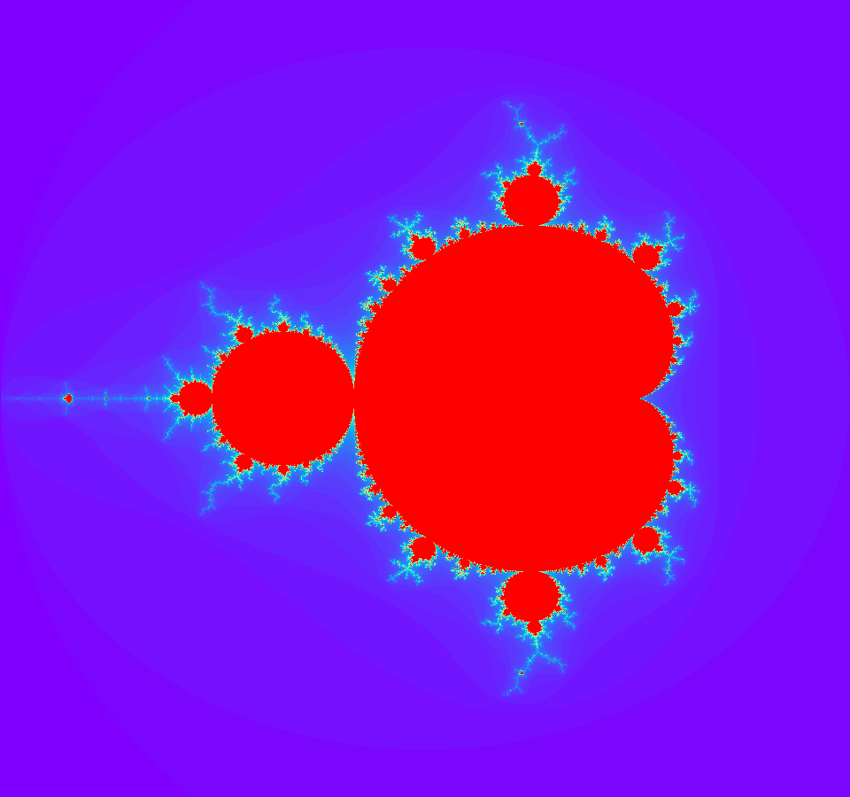

# rainy-nights-generating-fractals

  
   
  <em>quiet thoughts, endless patterns</em>

## Mandelbrot

The Mandelbrot set is defined by iterating:

$$
z_{n+1} = z_n^2 + c, \qquad z_0 = 0
$$

where $c$ is a complex number. 

A point belongs to the set if the sequence remains bounded.

## Barnsley fern

Barnsley's fern is generated using four affine transformations. Each transformation is defined as:

$$
f_i(x, y) =
\begin{bmatrix}
a&b\\
c&d
\end{bmatrix}
\begin{bmatrix}
x\\
y
\end{bmatrix}
+
\begin{bmatrix}
e\\
g
\end{bmatrix}
$$

The four transformation are:

*1. Stem (1%)*

$$
f_1 (x,y) =
\begin{bmatrix}
0.00&0.00\\
0.00&0.16
\end{bmatrix}
\begin{bmatrix}
x\\
y
\end{bmatrix}
$$

*2. Successively smaller leaflets (85%)*

$$
f_2 (x,y) =
\begin{bmatrix}
0.85&0.04\\
-0.04&0.85
\end{bmatrix}
\begin{bmatrix}
x\\
y
\end{bmatrix}
+
\begin{bmatrix}
0.00\\
1.60
\end{bmatrix}
$$

*3. Largest left-hand leaflet (7%)*

$$
f_3 (x,y) = \begin{bmatrix}
0.20&-0.26\\
0.23&0.22
\end{bmatrix}
\begin{bmatrix}
x\\
y
\end{bmatrix}
+
\begin{bmatrix}
0.00\\
1.60
\end{bmatrix}
$$

*4. Largest right-hand leaflet (7%)*

$$
f_4 (x,y) =
\begin{bmatrix}
-0.15&0.28\\
0.26&0.24
\end{bmatrix}
\begin{bmatrix}
x\\
y
\end{bmatrix}
+
\begin{bmatrix}
0.00\\
0.44
\end{bmatrix}
$$